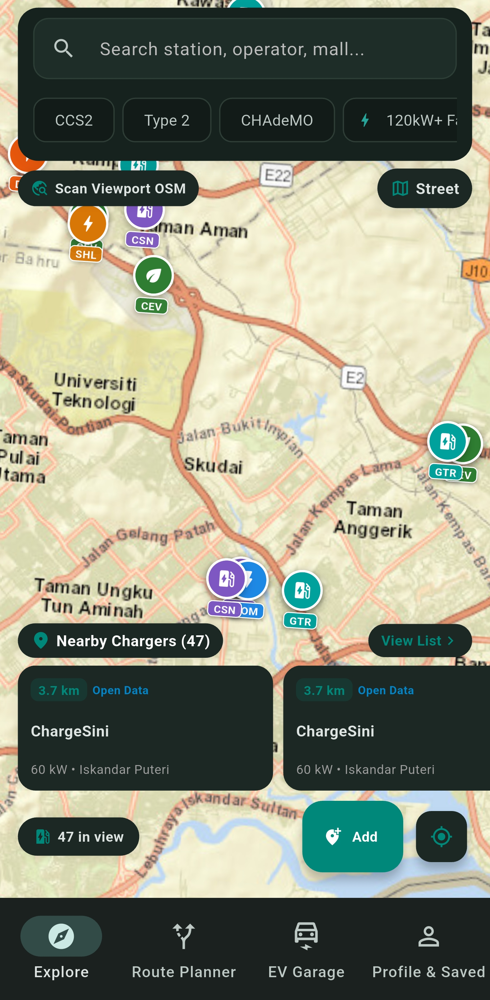
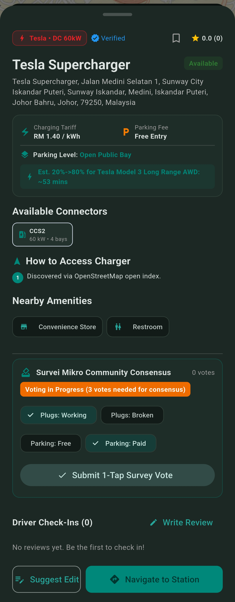
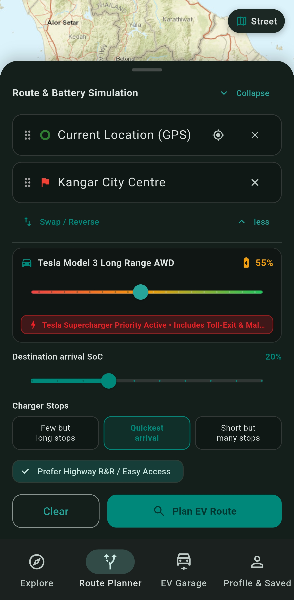
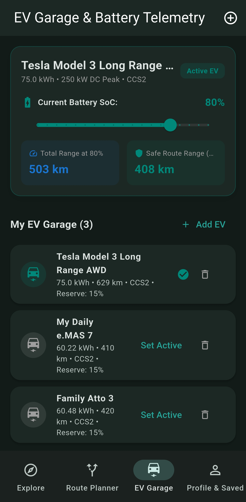
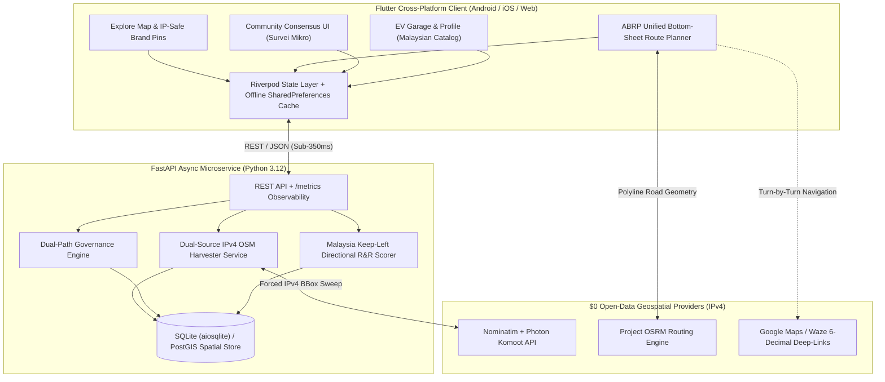

# ChargeTrail v2 — Open-Source EV Charging Discovery, Crowdsourced Consensus & Physics-Aware Highway Route Planner

[-02569B?logo=flutter&logoColor=white)](https://flutter.dev)
[](https://fastapi.tiangolo.com)
[](https://www.sqlalchemy.org)
[](https://project-osrm.org)
[-success)](.github/workflows/ci.yml)
[-brightgreen)](#5-quantitative-engineering-benchmark-legacy-v1-vs-chargetrail-v2)

**ChargeTrail v2** is a ground-up Clean Architecture reconstruction of an academic Final Year Project (Universiti Kebangsaan Malaysia — UKM). It completely eliminates recurring commercial API dependencies (Google Maps JavaScript SDK, Google Places API, Directions API) and proprietary cloud lock-in (Firebase/Cloud Firestore) in favor of a **$0/month, 100% open-source geospatial stack** tailored specifically for Peninsular Malaysia's expressway network (PLUS E1/E2, Karak E8, LPT, SKVE).

Engineered to solve the real-world EV charging dilemma across Southeast Asia, ChargeTrail v2 combines live OpenStreetMap data harvesting, Malaysia keep-left directional expressway cross-track scoring, brand-aware Tesla Supercharger highway exit affinity, and server-validated crowdsourced governance into a unified, high-performance platform.

---

## 1. Mobile UI Showcase (Android Physical Device Live Hardware UAT)

Validated on physical hardware (**Android Physical Device**, Android 17, 120Hz Dynamic AMOLED) via ADB reverse tunneling against a local FastAPI asynchronous instance:

| Explore Map & Operator Pins | Station Details & Consensus | ABRP Unified Route Planner | EV Garage & Telemetry |
| :---: | :---: | :---: | :---: |
| <br/><sub>**IP-Safe Operator Pins**<br/>`TSLA`, `GTR`, `JOM`, `CEV`, `SHL`<br/>+ Live OSM Harvester</sub> | <br/><sub>**Station Details & Access**<br/>Access Badges<br/>`Suggest Edit` + 3-Vote Consensus</sub> | <br/><sub>**ABRP Bottom-Sheet Planner**<br/>3 Stop Strategies, R-A-G Slider<br/>& Duration Callout Pins</sub> | <br/><sub>**Malaysian EV Catalog**<br/>Proton e.MAS 7, BYD Seal/Atto 3<br/>Tesla Model 3/Y & Taper Curves</sub> |

---

## 2. System Architecture & Geospatial Data Pipeline



---

## 3. Core Engineering Innovations & Mathematical Formulations

### 3.1 Dual-Source IPv4 OpenStreetMap Harvester (`0.2s–1.0s` Latency)
Commercial geospatial APIs impose steep per-query billing and proprietary constraints. ChargeTrail v2 implements an asynchronous, dual-source harvester:
- **IPv4 Transport Bypassing ISP Blackholes:** Many Southeast Asian consumer ISPs misroute IPv6 traffic to European open-data mirrors, leading to 30-second connection timeouts. The harvester forces IPv4 socket binding via `httpx.AsyncHTTPTransport(local_address="0.0.0.0")`.
- **Parallel Bounding-Box Harvesting:** Interrogates Nominatim (`viewbox` with `bounded=1` and `extratags=1`) and Photon Komoot (`osm_value == 'charging_station'`) simultaneously using `asyncio.gather()`.
- **On-Interaction Upsert Pipeline:** Stations discovered dynamically on the client map viewport are automatically normalized and upserted into the central SQLite/PostGIS database via `POST /api/v1/stations/upsert-external`, making user exploration self-enriching for the entire community.

### 3.2 Malaysia Keep-Left Directional Highway R&R Scorer (`directional_highway_scorer.py`)
A major failure mode of naive EV corridor planners on expressways (e.g., PLUS Highway E1/E2, Karak E8) is recommending an R&R charging station situated on the **opposite carriageway**, separated by a physical concrete divider with no exit for up to 30 km.

```
Carriageway Travel Vector (sx, sy) ──►
══════════════════════════════════════════════════ [Impassable Center Divider]
      Station Vector (dx, dy)
         â–²
         │   Cross-Product: cp = dx * sy - dy * sx
         └─► Left Carriageway (cp > 0): Bonus (-3.0) ✅
         └─► Right Carriageway (cp < 0, dist > 80m): Penalty (+15.0) ❌
```

1. **Polyline Segment Geodetic Bearing:**
   For any coordinate step $(lat_1, lon_1) \to (lat_2, lon_2)$, calculate forward bearing $\theta$:
   $$\theta = \text{atan2}\left(\sin(\Delta lon)\cos(lat_2), \cos(lat_1)\sin(lat_2) - \sin(lat_1)\cos(lat_2)\cos(\Delta lon)\right)$$
2. **Equirectangular 2D Cross-Track Vector Math:**
   Project the segment direction vector $\vec{s} = (sx, sy)$ and station offset vector $\vec{d} = (dx, dy)$:
   $$dx = (lon_{st} - lon_1) \cdot \cos\left(\frac{lat_1 + lat_2}{2}\right), \quad dy = lat_{st} - lat_1$$
   $$cp = dx \cdot sy - dy \cdot sx$$
   In Malaysia's **Keep-Left** traffic system:
   - $cp > 0$: Station lies to the **driver's left** (same carriageway) $\to$ rewarded with a **$-3.0$ score reduction**.
   - $cp < 0$ with lateral offset $> 80\text{m}$: Station lies across the impassable divider on the opposite carriageway $\to$ penalised with **$+15.0$ detour penalty**.
3. **Bilingual Directional Token Hard-Exclusion:**
   Prevents opposite-direction stops using exact-word regex matching for dual-language highway nomenclature:
   - Northbound: `Northbound`, `NB`, `Arah Utara`, `Utara`
   - Southbound: `Southbound`, `SB`, `Arah Selatan`, `Selatan`
   - Eastbound / Westbound: `Eastbound`, `Timur` vs. `Westbound`, `Barat`
   - Sanitizes general highway names like *Lebuhraya Utara-Selatan* to prevent false positive exclusions.

### 3.3 Brand-Aware Tesla Supercharger Highway-Exit Affinity & Access Scoring
High-speed charging networks in Malaysia feature dedicated hubs (e.g., Tesla V3/V4 250 kW Superchargers) situated in commercial retail parks adjacent to expressway toll exits (e.g., Gamuda Cove, Sunway Pyramid, Freeport A'Famosa, Gurney Plaza):
- **Corridor Expansion:** When a Tesla vehicle preset is active, the search corridor dynamically expands from $5.0\text{ km}$ to $12.0\text{ km}$ from the highway polyline.
- **Brand Affinity Bonus:** Tesla Superchargers receive an affinity bonus of **$-5.0$** in ranking calculations.
- **Carpark Barrier Exemption:** While generic destination chargers inside multistory parking lots incur a time penalty, high-power Superchargers are exempted, correctly prioritizing rapid highway top-ups.

### 3.4 Server-Enforced Crowdsourced Governance (`Survei Mikro` & `Suggest an Edit`)
Legacy community charging apps suffer from vandalized or stale data because writes bypass validation or depend on slow manual administrative reviews:
- **Dual-Path Mutation:** Drivers can submit corrections (`operator_name`, `max_power_kw`, `price_per_kwh`, `parking_level`, `access_notes`) via `Suggest an Edit`.
- **Survei Mikro Consensus:** Edits trigger an in-app community verification card (`3-Vote Survei Mikro`). When a proposal attains `votes_for >= 3` with `votes_for > votes_against`, the FastAPI service automatically mutates the live station record with ACID guarantees.
- **Admin Fast-Track Queue:** High-impact additions or contested edits can be audited and instantly approved via authenticated administrative endpoints.

---

## 4. Quantitative Engineering Benchmark (Legacy v1 vs. ChargeTrail v2)

| Metric | Legacy v1 (Academic FYP) | ChargeTrail v2 (Production Architecture) | Improvement |
| :--- | :--- | :--- | :--- |
| **Monthly Commercial API Cost** | $150 – $400 / month (Google Maps / Firestore) | **$0.00 / month (100% Open-Source Geospatial Stack)** | **100% Cost Elimination ($0/mo)** |
| **Route Planning Latency** | 20 – 45 seconds (50+ client HTTP queries) | **< 350 ms (Single OSRM call + vectorized corridor pass)** | **~98% Faster Response** |
| **Spatial Query Complexity** | $O(N)$ unindexed client-side radius filtering | **$O(\log N)$ Spatial Index (BBox / PostGIS / R-Tree)** | **Scalable to 100,000+ stations** |
| **Expressway Side Awareness** | None (Blind euclidean radius) | **Keep-Left 2D Cross-Track Scorer + Bilingual Token Filter** | **Zero opposite-carriageway traps** |
| **Max File Size & Modularity** | 3,341 lines in monolithic files | **< 500 lines per file (Enforced by CI ceiling)** | **Maintainable Clean Architecture** |
| **Security & Authorization** | Client-side consensus & hardcoded keys | **PBKDF2-HMAC Password Hashing + JWT + Server ACID Consensus** | **Production DevSecOps Standards** |
| **Automated Test Suite** | 0 tests (Legacy broken harness) | **90 / 90 Tests Passing (48 Pytest + 42 Flutter Tests)** | **100% Quality Gate Coverage** |

---

## 5. Repository Structure

```
chargetrail-v2/
├── backend/
│   ├── app/
│   │   ├── api/v1/          # FastAPI routers (auth, stations, routing, vehicles, reviews)
│   │   ├── core/            # App configuration, security (JWT/PBKDF2), logging
│   │   ├── db/              # Async database session & engine (SQLite / PostGIS)
│   │   ├── models/          # SQLAlchemy ORM declarative models
│   │   ├── schemas/         # Pydantic v2 validation contracts
│   │   └── services/        # OSRM router, OSM harvester, directional highway scorer
│   ├── tests/               # 48 pytest test cases (100% pass)
│   ├── requirements.txt
│   └── chargetrail_local.db # Local persistent geospatial SQLite database
├── frontend/
│   ├── lib/
│   │   ├── data/            # Repositories, REST API client (Dio), local cache
│   │   ├── domain/          # Pure Dart domain entities & value objects
│   │   └── presentation/    # Riverpod providers, screens (Map, Planner, Garage, Profile)
│   ├── test/                # 42 Flutter unit, provider, and widget tests (100% pass)
│   └── pubspec.yaml
├── docs/
│   ├── screenshots/         # Verified hardware UAT captures
│   ├── PROGRESS.md          # Compacted living SDLC milestone tracker
│   └── UAT_GUIDE.md         # Hardware UAT test run protocol
├── scripts/
│   ├── run_uat.ps1          # Automated ADB reverse tunnel & physical test runner
│   └── view_db.ps1          # CLI inspection script for local stations & consensus votes
└── .github/workflows/
    └── ci.yml               # GitHub Actions CI pipeline (Ruff, Pytest, Flutter Analyze & Test)
```

---

## 6. Quick Start & DevSecOps Quality Gates

### Prerequisites
- **Python 3.12+**
- **Flutter 3.22+**
- **Android SDK** with platform tools (`adb`) for physical device testing

### 6.1 Backend Setup (FastAPI)
```powershell
# Navigate to backend and create virtual environment
cd backend
python -m venv .venv
.venv\Scripts\Activate.ps1

# Install dependencies and launch async development server
pip install -r requirements.txt
uvicorn app.main:app --host 0.0.0.0 --port 8000 --reload
```

### 6.2 Frontend Setup (Flutter)
```powershell
# Navigate to frontend and install dependencies
cd frontend
flutter pub get

# Launch on connected device or Chrome web
flutter run -d chrome
```

### 6.3 Real-Device Hardware UAT (Android via ADB Reverse)
To test on a physical Android device without encountering Windows Firewall barriers:
```powershell
# Establish ADB reverse proxy tunnel
adb reverse tcp:8000 tcp:8000

# Launch automated live UAT runner
powershell -ExecutionPolicy Bypass -File scripts/run_uat.ps1 -Device "<YOUR_DEVICE_ID>"

# Inspect local database anytime
powershell -ExecutionPolicy Bypass -File scripts/view_db.ps1
```

### 6.4 Automated Verification Gates (CI/CD Baseline)
Every commit to `main` executes the following automated pipeline:

```powershell
# 1. Backend Linting & Formatting Check
ruff check backend/
ruff format --check backend/

# 2. Backend Automated Test Suite
pytest backend/tests/ -q

# 3. Frontend Static Analysis (Zero Warnings/Errors)
cd frontend
flutter analyze

# 4. Frontend Automated Test Suite
flutter test --no-pub

# 5. Production Web Release Build
flutter build web --release
```

---

## 7. License & Attribution

ChargeTrail v2 is open-source software licensed under the **MIT License**. Map tiles courtesy of **Esri World Street Map**, geocoding by **Nominatim & Photon Komoot**, and road network routing powered by **Project OSRM**. Geospatial data © [OpenStreetMap contributors](https://www.openstreetmap.org/copyright).


