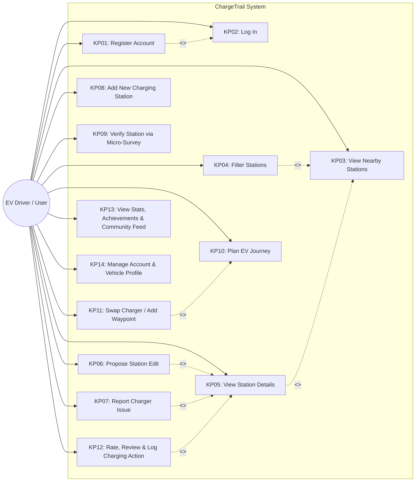
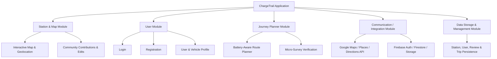
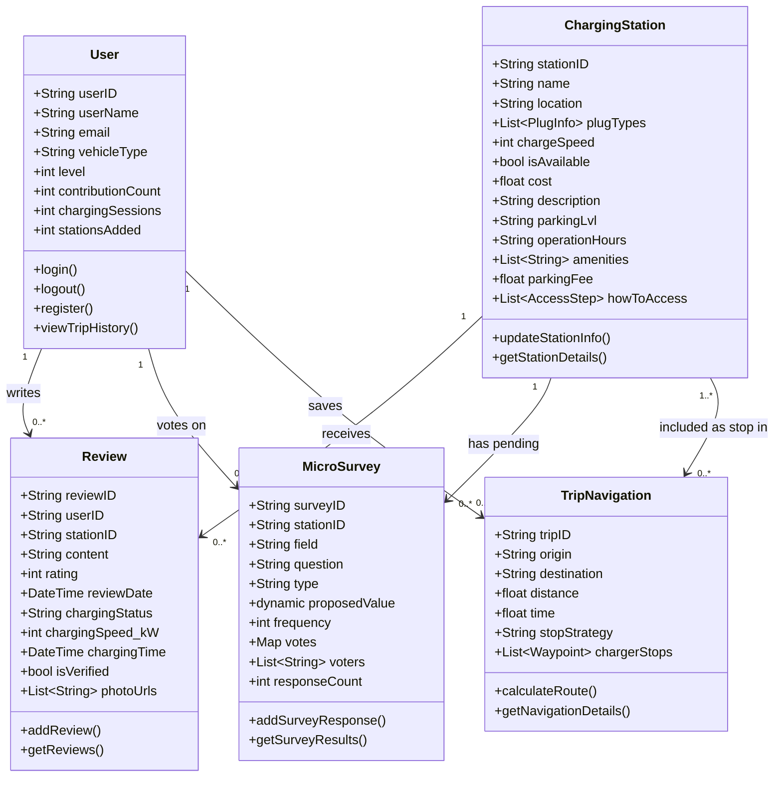
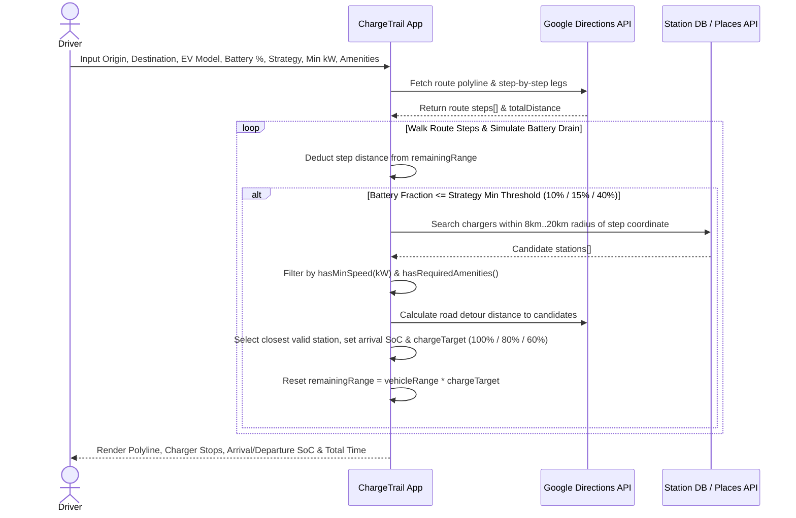

# ChargeTrail: Thesis Engineering Blueprint & Legacy Audit Synthesis

**Original Thesis Title:** ChargeTrail: Aplikasi Berasaskan Komuniti Pencarian Tempat Pengecasan Kenderaan Elektrik (EV) dan Perancangan Perjalanan  
**Author:** Muhammad 'Ariff Bin Mohd Zakaria (A193193), Universiti Kebangsaan Malaysia (2025)  
**Target Evolution:** `chargetrail-v2` (Production-Grade Revamp)

---

## 1. Executive Summary & Core Problem Statement

### 1.1 The 4 Core Problems Identified in Thesis (Bab I, Section 1.2)
1. **Fragmented Charging Ecosystem:** EV drivers in Malaysia must download multiple operator-specific apps (Gentari, JomCharge, chargEV, ChargeSini, etc.) just to check charger availability, plug types, pricing, and status. Data formats across these apps are inconsistent and incomplete.
2. **"Hidden" & Unlisted Chargers:** Many public-accessible chargers located inside car dealerships, hotels, shopping mall basements, or recreational areas are not registered on public maps (like Google Maps or Waze). Usually, only experienced EV drivers know about them, and their operating hours/access rules change frequently.
3. **Lack of Guidance for New EV Adopters:** New EV owners struggle to understand their vehicle's real-world range, optimal charging habits, exact parking bay/floor locations, and how to access hidden chargers—knowledge typically held only by seasoned EV drivers.
4. **Inefficient Manual Journey Planning:** Existing local apps lack intelligent, customizable route planning that accounts for specific EV battery capacities, state of charge (SoC), charger speeds, and driver-preferred stop strategies (e.g., quick stops vs. long dining/rest stops).

### 1.2 Proposed Solution Pillars (Bab I, Section 1.3 & Bab II, Section 2.5)
- **Unified Crowdsourced Station Hub:** Combine commercial map data (Google Maps/Places) with community-contributed stations, real-world access photos ("How to access charger"), exact floor/parking levels, parking fees, and live driver reports.
- **Micro-Survey Community Verification (`Survei Mikro`):** A Waze-like consensus mechanism where nearby or recent visitors answer quick Yes/No/Multiple-Choice prompts to verify user-submitted edits or new charger locations (requiring >= 5 votes with majority approval).
- **Battery-Aware Flexible Route Planner:** An algorithm that calculates multi-stop EV journeys based on vehicle range, starting battery %, minimum charger kW speed, stop strategy (*Few long stops*, *Quickest*, *Short many stops*), and required amenities (Restroom, Dining, Shopping, Security, Family/Pet Friendly).
- **Community Knowledge & Forum/Feed:** A space for experienced EV owners to share tips, route experiences, and real-time charging status (*Charging*, *Finish Charging*, *Could Not Charge*, *Waiting in Queue*) with newcomers.

---

## 2. Competitive Benchmark Analysis (Bab II, Jadual 2.1)

| Aspect | Agmo EV SuperApp | A Better Route Planner (ABRP) | ChargeTrail (Thesis Target) |
| :--- | :--- | :--- | :--- |
| **Map Data Accuracy (Malaysia)** | High coverage for commercial operators in Malaysia, but 100% reliant on operator updates (no community edits for hidden chargers). | Global database, but sparse/incomplete for local Malaysian chargers and hidden dealership/mall bays. | Hybrid: Google Places API + Community-added hidden stations & step-by-step access photo guides. |
| **Community Contribution** | Star ratings & text reviews only. Cannot edit station metadata or report broken chargers directly into station specs. Has voting for future charger sites. | Only binary/ternary survey prompts (Yes / No / Not Sure). No written reviews, access photos, or community station editing. | Full crowdsourcing: Add hidden stations, propose field edits, upload access photos, log live queue/charging status, and verify via Micro-Surveys. |
| **Journey Planner** | Basic shortest-path summary; relies on external Google Maps for navigation; lacks granular energy/charging time customization. | Highly detailed energy & battery curve modeling, but overly complex UI for beginners; real-time traffic/weather locked behind paid subscription. | Balanced & intuitive: Vehicle-specific range simulation + 3 clear stop strategies + amenity filtering + alternative charger swapping. |
| **Information Sharing** | Closed inside the app; no route sharing or community forum. | Supports link/plan sharing and calendar/Excel export. | Community activity feed, verified contributor badges, leaderboards, and saved trips/stations. |
| **User Interface (UI/UX)** | Clean, beginner-friendly, and localized for Malaysia. | Complex, technical, and overwhelming for new EV owners. | Minimalist, intuitive, visual step-by-step access cards tailored for both new and veteran EV drivers. |

---

## 3. System Requirements Specification (Bab III, Section 3.3)

### 3.1 Functional Requirements (`Keperluan Fungsian` KF1 - KF14)
| ID | Requirement Name | Core Specification |
| :--- | :--- | :--- |
| **KF01** | Account Registration | Register via Email/Password or 3rd-party OAuth (Google Sign-In) with email verification & profile initialization. |
| **KF02** | User Login | Authenticate via Email/Password or Google OAuth and redirect to main map dashboard. |
| **KF03** | Main Map & Nearby Stations | Detect user GPS (`Geolocator`) and display nearby EV chargers (within 5km / viewport) using color-coded markers (Community/Firestore vs. API). |
| **KF04** | Station Filtering | Filter stations by Connector Type (CCS2, Type 2, CHAdeMO), Charger Speed (kW), Amenities (Dining, Restroom, Shopping, Security), 24-Hour status, and Star Rating. |
| **KF05** | Station Details View | Display name, distance, available plugs & kW, charging cost, parking fee, parking level/landmark, community description, operating hours, amenities, step-by-step "How to Access" photos, and user reviews. |
| **KF06** | Edit Station Info | Allow users to propose edits to station fields (cost, hours, plugs, amenities, access photos). Unverified user edits enter a `pending` verification queue. |
| **KF07** | Report Charger Issue | Under "Charging Action -> Could Not Charge", allow users to report faults (Blocked, Malfunctioning, App Error, Power Outage) with photo evidence. |
| **KF08** | Add New Station | Allow users to pin a new/hidden charger on the map, enter plug/access details, mark if private property, and submit for community verification. |
| **KF09** | Community Verification (`Survei Mikro`) | Present pop-up or Contribute-tab micro-surveys (Yes / No / Not Sure / Multiple Choice) to users to validate pending edits or new stations (>= 5 votes required). |
| **KF10** | Journey Planning (`Trip`) | Calculate EV routes based on Origin, Destination, Vehicle Model (initially scoped to Tesla Model 3/Y & BYD Dolphin/Seal, extensible to custom EVs), Current Battery %, Stop Strategy, Min Charger kW, and Preferred Amenities. |
| **KF11** | Route Customization | Allow drivers to swap recommended charging stops with alternative nearby stations or add extra waypoints. |
| **KF12** | Active Charging & Reviews | Support 4 live states (*Charging* with timer, *Finish Charging*, *Could Not Charge*, *Waiting* queue timer) and verified reviews (restricted to users with `visit_history`). |
| **KF13** | User Stats & Community Feed | Track user level, charging sessions, contributions, stations added, leaderboard, and nearby 5km community activity feed. |
| **KF14** | User & Vehicle Profile | Manage personal info, password/auth linking, EV vehicle specs, Saved Stations, and Saved Trips. |

### 3.2 Non-Functional Requirements (`Keperluan Bukan Fungsian`)
- **Availability:** 99.9% uptime target with graceful offline/error recovery and user notifications when network drops.
- **Security:** Encrypted transport/storage, Multi-Factor/OAuth authentication, protection against injection/XSS, and strict authorization rules.
- **Performance (`Kecekapan`):** < 2 seconds response time for core station search and map rendering; scalable under concurrent user load.
- **Usability:** Minimalist, high-clarity UI/UX validated by user testing (100% satisfaction on search/filter, 83.3% strong recommendation rate in Bab IV survey).

---

## 4. Visual Diagrams Converted to Mermaid.js (From Bab III)

### 4.1 System Use Case Diagram (Rajah 3.1)


### 4.2 High-Level Architecture & Module Hierarchy (Rajah 3.30 & Rajah 3.31)


### 4.3 Domain Class Diagram & Data Dictionary (Rajah 3.32 & Jadual 3.17 - 3.26)


### 4.4 Core Algorithms & Sequence Flows (Rajah 3.34 - 3.38 & Bab IV Code)

#### A. Battery-Aware Route Planning Flow


#### B. Community Edit & Micro-Survey Consensus Flow
```mermaid
flowchart TD
    A[User Submits Station Edit / New Station] --> B{Is User Verified Contributor?}
    B -- Yes --> C[Directly Update Live Station Document]
    B -- No --> D{Check if Pending Verification Exists for Field}
    D -- Exists --> E[Skip Duplicate & Notify User]
    D -- New --> F[Create Document in stations/{id}/verifications]
    F --> G[Display Micro-Survey to Nearby / Contributing Users]
    G --> H[User Votes: Yes / No / Not Sure]
    H --> I[Increment Vote Counter & Append UID to voters[]]
    I --> J{Total Yes + No Votes >= 5?}
    J -- No --> G
    J -- Yes --> K{Is Yes > No?}
    K -- Yes --> L[Update Main Station Document with Proposed Value & Delete Verification Doc]
    K -- No --> M[Mark Verification Rejected & Remove]
```

---

## 5. Synthesis: Thesis Limitations vs. Codebase Audit (What `chargetrail-v2` Must Solve)

| Area | Thesis Vision & Future Work (Bab V) | Legacy Codebase Reality (`LEGACY_AUDIT.md`) | Target `chargetrail-v2` Engineering Solution |
| :--- | :--- | :--- | :--- |
| **Data Sources & Real-Time Status** | Thesis notes lack of official CPO real-time data and complex dual-source sync (Google Maps + Firestore). | App downloads the *entire* Firestore `stations` collection into phone memory ($O(N)$ full scan) and polls active sessions every 1 second (3,600 reads/hr/user). | **Spatial Indexing (PostGIS / GeoFirestore) + WebSockets/Streams:** Query only viewport bounding boxes; use local clock countdowns + server-side session expiration triggers. |
| **Route Planning Engine** | Thesis highlights need for accurate battery/terrain/weather routing and alternative charger swapping. | Client executes nested loops calling Google Directions API 50-100+ times per trip calculation, causing 30s+ freezes, API key exposure, and rate limits. | **Backend Routing Service:** Move route simulation to a backend API (e.g., FastAPI / Cloud Functions) using spatial corridor queries + single Distance Matrix call. |
| **Community Verification Security** | Thesis designs a 5-vote consensus system (`Survei Mikro`) to prevent bad data and reward contributors. | Consensus logic runs on the client (`verify_modal.dart`) with no Firestore rules, allowing any user to spoof votes or overwrite stations directly. | **Server-Enforced Consensus & RBAC:** Handle votes, reputation points, and station mutations strictly on the backend or via locked-down database triggers. |
| **Offline & Rural Connectivity** | Thesis Section 5.3 notes heavy reliance on stable internet, which fails in rural highway stretches. | Zero local caching; app crashes on startup if `.env` is missing; untyped `Map<String, dynamic>` data causes runtime null errors. | **Offline-First Caching + Strict Typing:** Cache stations and saved trip plans locally (Isar / SQLite / Hive) with strongly typed models (`Freezed` / TypeScript / Pydantic). |
| **New Features Proposed in Thesis (Section 5.4)** | 1. Official CPO real-time status integration.<br>2. Gamified rewards, badges & active user leaderboard.<br>3. Smart push notifications (low battery / nearby verification prompts).<br>4. Multi-language support (BM, EN, ZH). | Basic level/contribution counters exist, but no push notification service, no i18n localization framework, and broken test suite (154 lint warnings). | **Built-in v2 Modules:** i18n localization from Day 1, push notification hooks (FCM), structured gamification engine, and automated CI/CD linting/testing. |


